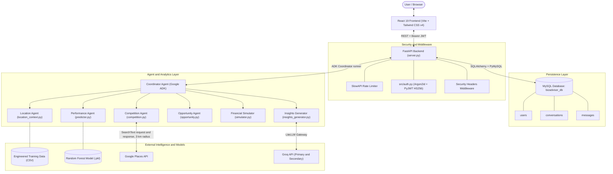
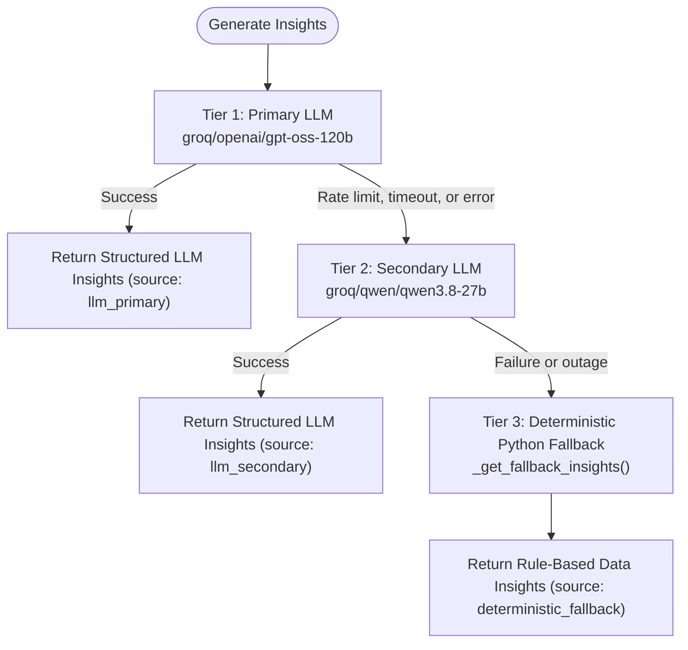
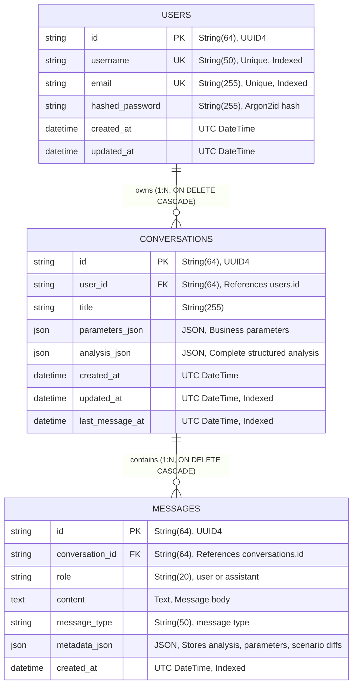

# BizAdvisor: AI-Powered Restaurant Feasibility Platform

An AI-powered business intelligence and decision-support platform designed to evaluate the commercial feasibility of restaurant ventures in Bengaluru, India.

**Project:** BizAdvisor  
**Developer:** Tanay Chaturvedi  
**Domain:** Artificial Intelligence and Machine Learning  

> BizAdvisor combines machine learning performance prediction, live geospatial competitor discovery via Google Places, deterministic monthly financial modeling, and structured AI-generated business insights into an integrated advisory workflow.

---

## 1. Core Capabilities

- **Required Parameter Validation:** Validates that all six essential business parameters (`location`, `primary_cuisine`, `primary_rest_type`, `approx_cost_for_two`, `online_order`, `book_table`) are present before triggering analysis. If inputs are missing, the system requests them rather than guessing.
- **Machine Learning Performance Prediction:** A Scikit-Learn `RandomForestClassifier` (300 estimators) trained on 33,332 historical Bengaluru restaurant records predicts expected performance tier (`High`, `Medium`, or `Low`) along with class probability distributions.
- **Live Competitor Discovery:** Converts human-readable Bengaluru localities into geographic coordinates and queries the Google Places API (`places:searchText`) for up to 20 direct competitors within a 3 km radius, calculating average ratings and review counts.
- **Composite Opportunity Score (0–100):** Combines historical ML performance indicators (60% weight) and local competitive saturation (40% weight) into an opportunity score and risk tier (`Low`, `Moderate`, or `High`).
- **Deterministic Monthly Financial Modeling:** Calculates monthly revenue, variable food costs, itemized operating expenses (rent, staff, utilities, marketing, other), estimated operating profit, operating profit margin %, and break-even customer targets per day and month.
- **Interactive What-If Scenario Analysis:** Compares baseline concepts against operational and financial parameter adjustments (e.g., changes in customer volume, rent, or staff costs) without retraining the ML model or making new Google Places API calls.
- **Three-Tier Resilient AI Insights:** Generates 2–3 structured insight bullets per analysis section using a dual-model LLM failover hierarchy backed by a deterministic Python fallback:
  1. Primary LLM via LiteLLM (`groq/openai/gpt-oss-120b`)
  2. Secondary LLM fallback (`groq/qwen/qwen3.8-27b`)
  3. Deterministic Python rule-based insights (`_get_fallback_insights`)
- **User Authentication & Session Persistence:** Argon2id password hashing, PyJWT access tokens, rate limiting via SlowAPI, and full conversation/analysis persistence in MySQL with cascading deletes.
- **Frontend Dashboard:** React 19 single-page application built with Vite and Tailwind CSS v4, featuring analytical cards, interactive What-If sliders, Leaflet competitor maps, and Web Speech API audio synthesis.

---

## 2. System Architecture



### Specialist Agent Responsibilities

| Agent / Module | Primary Function | Inputs | Outputs | Responsibility Boundary |
| :--- | :--- | :--- | :--- | :--- |
| **Location Agent** | Retrieves historical neighborhood metrics | `location` | Historical restaurant count, median cost, online order rate, table booking rate | Reads historical data from processed Zomato dataset. Does not query live APIs. |
| **Performance Agent** | Evaluates business inputs using Random Forest | 7 user inputs + 6 historical location metrics | Predicted class (`High`, `Medium`, `Low`) and class probability distribution | Loads preprocessor and model from `models/`. Does not calculate financial profit or guarantee success. |
| **Competition Agent** | Discovers nearby direct competitors | `location`, `search_query`, radius (3 km), max results (20) | Nearby competitors list, count, average rating, review count | Calls Google Places API (`places:searchText`). Raises error if `GOOGLE_MAPS_API_KEY` is missing. |
| **Opportunity Agent** | Calculates composite opportunity score | Class probabilities, competition summary | Opportunity score (0–100) and risk signal | Deterministic mathematical calculation. Never alters ML probabilities. |
| **Financial Simulator** | Models monthly unit economics | Customer volume, average spend, rent, staff, expenses | Monthly revenue, expenses, operating profit, margin %, break-even targets | Deterministic Python calculation. Does not model taxes, loan interest, or delivery commissions. |
| **Insights Generator** | Produces structured analytical commentary | Business parameters and aggregated analysis results | 2–3 insight bullets for each of the 6 analysis sections | Single structured call. Tries Primary LLM $\rightarrow$ Secondary LLM $\rightarrow$ Deterministic Python fallback. |

---

## 3. Machine Learning & Predictive Analytics

- **Model Type:** Scikit-Learn `RandomForestClassifier` with 300 estimators, saved at `models/zomato_performance_model.pkl`.
- **Feature Preprocessor:** Scikit-Learn `ColumnTransformer` (handling one-hot encoding for categorical variables and standard scaling for numerical features), saved at `models/zomato_preprocessor.pkl`.
- **Training Dataset:** 33,332 cleaned and engineered historical restaurant records from Bengaluru (`data/processed/zomato_train_engineered.csv`).
- **Feature Inputs:**
  - *User Business Inputs:* `online_order`, `book_table`, `approx_costfor_two_people`, `log_cost`, `cost_band`, `location`, `primary_cuisine`, `cuisine_count`, `primary_rest_type`.
  - *Historical Location Context:* `historical_restaurant_count`, `location_median_cost`, `location_online_order_rate`, `location_book_table_rate`, `location_cuisine_diversity`, `location_business_type_diversity`.
- **Target Variable:** Performance tier (`High`, `Medium`, `Low`), reflecting historical customer engagement and dining ratings.
- **Probability Output:** Uses `predict_proba()` to compute class probabilities. In the UI, the Model Confidence metric displays the probability of the *predicted class* (e.g., if predicted class is `Medium` with 55.7% probability, Model Confidence displays 55.7%).
- **Important Note on Calibration:** Probabilities represent raw Random Forest tree voting distributions; they are not formally calibrated using Platt scaling or isotonic regression (`CalibratedClassifierCV`).

---

## 4. Financial Modeling & What-If Analysis

### Monthly Unit Economics (`src/finance/simulator.py`)

The financial simulator calculates monthly operational figures using standard managerial accounting:

$$\text{Monthly Revenue} = \text{Customers Per Day} \times \text{Working Days} \times \text{Average Order Value}$$

$$\text{Variable Food Cost} = \text{Monthly Revenue} \times \left(\frac{\text{Food Cost \%}}{100}\right)$$

$$\text{Fixed Operating Costs} = \text{Rent} + \text{Staff Cost} + \text{Utilities} + \text{Marketing} + \text{Other Expenses}$$

$$\text{Total Monthly Operating Expenses} = \text{Fixed Operating Costs} + \text{Variable Food Cost}$$

$$\text{Estimated Operating Profit} = \text{Monthly Revenue} - \text{Total Monthly Operating Expenses}$$

$$\text{Operating Profit Margin \%} = \left(\frac{\text{Estimated Operating Profit}}{\text{Monthly Revenue}}\right) \times 100$$

$$\text{Break-Even Target Customers/Day} = \left\lceil \frac{\text{Fixed Operating Costs}}{(\text{Average Order Value} - \text{Variable Cost Per Customer}) \times \text{Working Days}} \right\rceil$$

**Current Modeling Limitations:**
- Calculates estimated operating profit (EBITDA proxy); does not calculate net profit after taxes.
- Does not model GST, income tax, depreciation, loan interest/EMI, or food delivery aggregator commissions (e.g., Swiggy/Zomato fees).

### What-If Scenario Modeler (`src/analysis/what_if.py`)

The scenario engine provides side-by-side comparative analysis between baseline inputs and modified operational scenarios:
- **Financial What-If (`compare_financial_scenarios`):** Recalculates cost and revenue deltas when variables like rent, staff cost, or customer count change. Does not invoke the ML model or Google Places.
- **ML What-If (`compare_ml_scenarios`):** Re-evaluates model probabilities when operational features (e.g., table booking, cuisine, cost) change. Does not retrain the model or call Google Places.
- **Zero-Division Protection:** All percentage change calculations use `_safe_pct_change` to safely return `None` or `0.0` when baseline values are zero.

---

## 5. AI Insights & Resilient Failover Architecture

BizAdvisor uses a single-call structured insight generation pipeline with a 3-tier safety net to guarantee reliability:



- **Single Structured Request:** All six analysis sections (`location_insights`, `performance_insights`, `competition_insights`, `opportunity_insights`, `financial_insights`, `business_recommendations`) are generated in a single prompt.
- **Data Grounding:** The grounding payload provides exact calculated figures (e.g., predicted class, class probabilities, competitor count, average rating, operating margin %, break-even targets) directly to the prompt.
- **LiteLLM Sanitization:** A completion wrapper in `src/agent/llm_config.py` strips internal reasoning fields (such as `reasoning_content`) emitted by certain models before passing responses downstream.

---

## 6. Authentication, Security & Database Schema

### Security Implementation

- **Password Hashing:** Argon2id via `argon2-cffi` configured with `time_cost=2`, `memory_cost=65536` (64 MB), and `parallelism=1`.
- **Access Tokens:** PyJWT HS256 tokens with configurable expiration (default: 60 minutes) and issuer validation (`iss: "bizadvisor-api"`).
- **Startup Secret Validation:** Server fails to start if `JWT_SECRET_KEY` is missing, empty, shorter than 32 characters, or matches common insecure placeholders (e.g., `"secret"`, `"changeme"`).
- **Rate Limiting:** Managed via `SlowAPI` with in-memory limits per IP:
  - `/api/auth/register` & `/api/auth/login`: 10 requests / minute
  - `/api/analyze` & `/api/scenario`: 20 requests / minute
  - `/api/chat`: 30 requests / minute
  - `/api/financial/simulate`, `/api/history`, `/api/history/{session_id}` (GET): 60 requests / minute
  - `/api/history/{session_id}` (DELETE): 30 requests / minute
  - Global default: 120 requests / minute
- **Security Headers:** Injected via HTTP middleware:
  - `X-Content-Type-Options: nosniff`
  - `X-Frame-Options: DENY`
  - `X-XSS-Protection: 1; mode=block`
  - `Referrer-Policy: strict-origin-when-cross-origin`
  - `Permissions-Policy: geolocation=(), microphone=(), camera=()`
- **User Data Isolation:** All conversation and history queries enforce `user_id == current_user.id` to prevent cross-account data leakage.

### Database Schema (MySQL 8.0+)



---

## 7. API Endpoints Reference

All application endpoints are served by FastAPI (`server.py`):

| Method | Endpoint | Authentication | Rate Limit | Description |
| :--- | :--- | :---: | :---: | :--- |
| `POST` | `/api/auth/register` | Public | 10 / min | Register a new user account with username, email, and password. |
| `POST` | `/api/auth/login` | Public | 10 / min | Authenticate credentials; returns a Bearer JWT access token. |
| `GET` | `/api/auth/me` | Bearer JWT | 120 / min | Retrieve the authenticated user's profile. |
| `GET` | `/api/health` | Public | 120 / min | Service health check reporting operational status. |
| `POST` | `/api/analyze` | Bearer JWT | 20 / min | Run full analysis directly from structured request parameters. |
| `POST` | `/api/chat` | Bearer JWT | 30 / min | Conversational business analysis endpoint with 6-input validation. |
| `POST` | `/api/scenario` | Bearer JWT | 20 / min | Run What-If comparative analysis between baseline and scenario parameters. |
| `POST` | `/api/financial/simulate` | Public | 60 / min | Recalculate deterministic unit economics from input assumptions. |
| `GET` | `/api/history` | Bearer JWT | 60 / min | List conversations belonging to the authenticated user (supports `?search=`). |
| `GET` | `/api/history/{session_id}` | Bearer JWT | 60 / min | Retrieve full conversation turn history and analysis payload by ID. |
| `DELETE`| `/api/history/{session_id}` | Bearer JWT | 30 / min | Delete a conversation and its messages (cascaded). |

---

## 8. Environment Variables

All configuration is loaded from `.env` using `python-dotenv`:

| Variable Name | Required | Default Value | Description |
| :--- | :---: | :--- | :--- |
| `PRIMARY_LLM_PROVIDER` | No | `groq` | LiteLLM provider for primary model. |
| `PRIMARY_LLM_MODEL` | No | `openai/gpt-oss-120b` | Model identifier for primary reasoning. |
| `PRIMARY_LLM_API_KEY` | **Yes** | — | Primary LLM API key (or `GROQ_API_KEY`). |
| `PRIMARY_LLM_BASE_URL` | No | `https://api.groq.com/openai/v1` | Base URL for primary LLM endpoint. |
| `SECONDARY_LLM_PROVIDER` | No | `groq` | LiteLLM provider for secondary fallback model. |
| `SECONDARY_LLM_MODEL` | No | `qwen/qwen3.8-27b` | Model identifier for secondary fallback model. |
| `SECONDARY_LLM_API_KEY` | No | — | Optional secondary API key (falls back to primary key if unset). |
| `SECONDARY_LLM_BASE_URL`| No | `https://api.groq.com/openai/v1` | Base URL for secondary LLM endpoint. |
| `GOOGLE_MAPS_API_KEY` | **Yes** | — | Google Places API key for text search (`places:searchText`). |
| `MYSQL_HOST` | No | `localhost` | MySQL host address. |
| `MYSQL_PORT` | No | `3306` | MySQL connection port. |
| `MYSQL_USER` | No | `root` | MySQL user. |
| `MYSQL_PASSWORD` | No | `""` | MySQL user password. |
| `MYSQL_DATABASE` | No | `bizadvisor_db` | MySQL database name. |
| `JWT_SECRET_KEY` | **Yes** | — | Cryptographically random secret of at least 32 characters. |
| `JWT_ALGORITHM` | No | `HS256` | JWT signing algorithm. |
| `ACCESS_TOKEN_EXPIRE_MINUTES` | No | `60` | Token validity duration in minutes. |
| `JWT_ISSUER` | No | `bizadvisor-api` | Token issuer validation string. |
| `CORS_ALLOWED_ORIGINS` | No | `http://localhost:5173,http://127.0.0.1:5173,http://localhost:8000,http://127.0.0.1:8000` | Comma-separated list of allowed CORS origins. |

---

## 9. Project Directory Structure

```
Business_Analysis_Agent/
├── data/
│   ├── processed/
│   │   ├── zomato_cleaned.csv            # Cleaned baseline dataset
│   │   ├── zomato_train_engineered.csv    # Engineered training data (33,332 rows)
│   │   └── zomato_test_engineered.csv     # Engineered test data (8,334 rows)
│   └── raw/
│       └── zomato.csv                     # Original raw dataset
├── frontend/                              # React 19 SPA (Vite + Tailwind CSS v4)
│   ├── src/
│   │   ├── components/
│   │   │   ├── Analysis/                  # Analytical cards (Location, Performance, etc.)
│   │   │   ├── AudioPlayer/               # Web Speech API TTS player
│   │   │   ├── Auth/                      # Authentication modals
│   │   │   ├── Chat/                      # Message list & input components
│   │   │   ├── Map/                       # Leaflet interactive map modal
│   │   │   ├── Scenario/                  # What-If scenario builder drawer
│   │   │   └── Sidebar/                   # Conversation history sidebar
│   │   ├── services/
│   │   │   └── api.js                     # Axios HTTP client with JWT interceptor
│   │   ├── App.jsx                        # Root React component
│   │   ├── index.css                      # Styling & theme variables
│   │   └── main.jsx                       # DOM entrypoint
│   ├── package.json
│   └── vite.config.js
├── models/
│   ├── zomato_performance_model.pkl       # 300-estimator Random Forest classifier
│   └── zomato_preprocessor.pkl            # Scikit-Learn ColumnTransformer
├── notebooks/                             # Exploratory data analysis & training
│   ├── 01_data_cleaning.ipynb
│   ├── 02_feature_engineering.ipynb
│   └── 05_zomato_model_training.ipynb
├── src/
│   ├── agent/                             # Multi-agent orchestration
│   │   ├── adk_runner.py                  # Google ADK runner interface
│   │   ├── agent.py                       # Root agent registration
│   │   ├── competition_agent.py           # Competitor analysis agent
│   │   ├── coordinator_agent.py           # Master coordinator pipeline
│   │   ├── insights_generator.py          # Structured AI insights & fallback
│   │   ├── llm_config.py                  # LiteLLM client & provider config
│   │   ├── location_agent.py              # Location context agent
│   │   ├── opportunity_agent.py           # Opportunity scoring agent
│   │   └── performance_agent.py           # ML performance agent
│   ├── analysis/
│   │   ├── location_context.py            # Historical neighborhood metrics lookup
│   │   ├── opportunity.py                 # Opportunity score algorithm
│   │   └── what_if.py                     # What-If comparative scenario logic
│   ├── finance/
│   │   └── simulator.py                   # Deterministic unit economics model
│   ├── places/
│   │   └── competition.py                 # Google Places API client
│   ├── auth.py                            # Argon2id password hashing & PyJWT
│   └── database.py                        # SQLAlchemy MySQL models & session pool
├── tests/
│   ├── test_financial_accuracy.py         # Financial calculation unit tests (11 tests)
│   ├── test_mysql_integration.py          # Database CRUD integration tests (4 tests)
│   ├── test_mysql_regression.py           # Session recovery regression tests (4 tests)
│   └── test_security.py                   # Auth, JWT, rate limiting tests (14 tests)
├── .env.example                           # Sample environment configuration
├── requirements.txt                       # Backend Python dependencies
├── server.py                              # FastAPI backend entrypoint
└── README.md
```

---

## 10. Installation & Setup

### Prerequisites
- **Python:** 3.11 or higher
- **Node.js:** 18 or higher (with npm)
- **MySQL:** 8.0 or higher
- **API Keys:**
  - Google Maps API key with the **Places API (New)** enabled.
  - Groq API key (for primary and secondary LLM inference).

### 1. Set Up Python Virtual Environment
```powershell
# Create and activate virtual environment
python -m venv .venv
.\.venv\Scripts\Activate.ps1

# Install backend dependencies
python -m pip install --upgrade pip
pip install -r requirements.txt
```

### 2. Configure Environment Variables
Copy `.env.example` to `.env` and fill in your database credentials and API keys:
```powershell
Copy-Item .env.example .env
```
Ensure that `JWT_SECRET_KEY` is a secure random string of at least 32 characters.

### 3. Initialize MySQL Database
Create the database in MySQL:
```sql
CREATE DATABASE IF NOT EXISTS bizadvisor_db CHARACTER SET utf8mb4 COLLATE utf8mb4_unicode_ci;
```
Database tables (`users`, `conversations`, `messages`) are created automatically when the FastAPI server starts via `Base.metadata.create_all(bind=engine)`.

### 4. Install Frontend Dependencies
```powershell
cd frontend
npm install
cd ..
```

---

## 11. Running the Application

### Development Mode

Run the backend and frontend in separate terminal windows:

**Terminal 1 — Backend:**
```powershell
.\.venv\Scripts\Activate.ps1
uvicorn server:app --host 127.0.0.1 --port 8000 --reload
```
The API is available at `http://127.0.0.1:8000` (interactive documentation at `http://127.0.0.1:8000/docs`).

**Terminal 2 — Frontend:**
```powershell
cd frontend
npm run dev
```
The frontend is available at `http://localhost:5173`.

### Production Build

To build the frontend and serve it directly through FastAPI:
```powershell
cd frontend
npm run build
cd ..
uvicorn server:app --host 0.0.0.0 --port 8000
```

---

## 12. Testing & Verification

The test suite contains **33 automated tests** covering financial formulas, authentication security, database cascades, and session concurrency.

Run the test suite with pytest:
```powershell
pytest tests/ -v
```

### Test Suite Summary:
- **`tests/test_financial_accuracy.py` (11 tests):** Verifies monthly revenue, food costs, operating profit, margins, break-even customer formulas, zero-revenue safety, and invalid input rejection.
- **`tests/test_security.py` (14 tests):** Verifies Argon2id password hashing, credential validation, JWT token expiration, route protection, cross-user data isolation, rate limiting, and startup secret key validation.
- **`tests/test_mysql_integration.py` (4 tests):** Verifies MySQL schema generation, conversation CRUD, cascading deletes, and analysis payload persistence.
- **`tests/test_mysql_regression.py` (4 tests):** Verifies multi-turn session creation, conversation updates, and recovery from stale session data.

---

## Developer & Project Information

- **Developer:** Tanay Chaturvedi
- **Domain:** Artificial Intelligence and Machine Learning
- **Project:** BizAdvisor — Restaurant Feasibility & Business Advisory Platform
