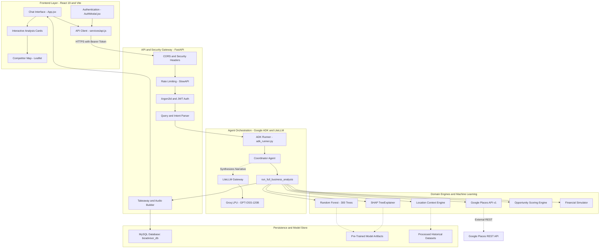
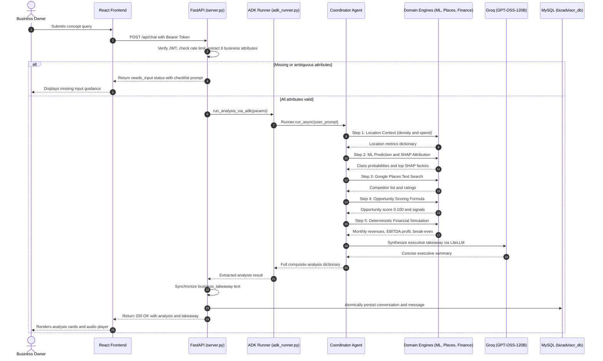
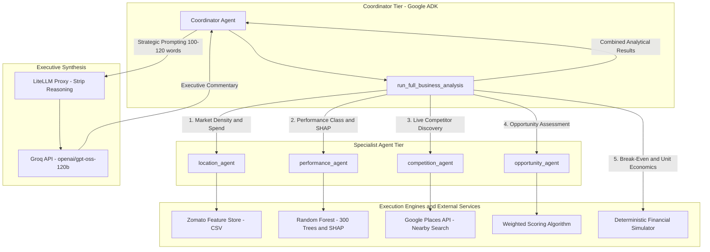
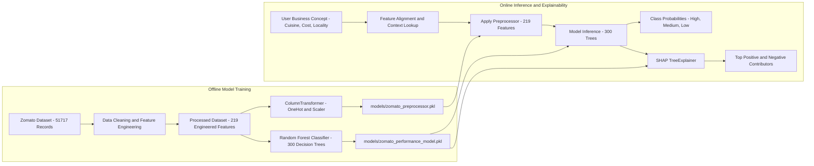
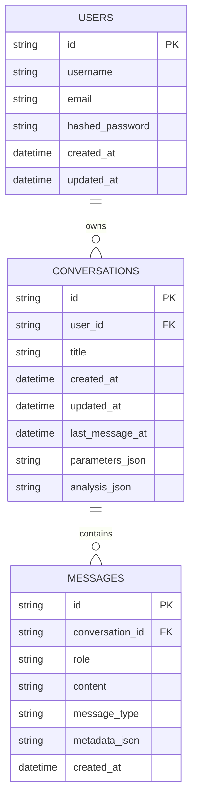

# BizAdvisor: AI-Based Business Opportunity Assessment & Advisory System

BizAdvisor is a full-stack, machine learning-driven decision support system that I developed to evaluate restaurant and hospitality business concepts. The platform combines offline-trained predictive machine learning, real-time geospatial competitor discovery, management accounting principles, and multi-agent LLM orchestration to provide aspiring entrepreneurs and operators with data-backed feasibility reports before investing capital.

---

## 1. Project Title & Introduction

**BizAdvisor: AI-Based Business Opportunity Assessment & Advisory System**
**Author:** Tanay Chaturvedi (AI & Machine Learning Engineering Student)

When evaluating a new restaurant idea, operators are typically forced to choose between black-box statistical reports, expensive market research consultants, or generic conversational chatbots that lack real domain data and mathematical consistency.

I designed BizAdvisor as an integrated advisory system that bridges this gap. It captures high-level business ideas through natural conversation, validates essential commercial variables, runs historical machine learning predictions, queries live nearby competitor density via Google Places, calculates deterministic unit economics, and synthesizes executive advisory takeaways through Google ADK agents and Groq-hosted open-weights reasoning models.

---

## 2. Why I Built BizAdvisor

During my research into hospitality unit economics and local commerce datasets, I noticed a consistent pattern: a significant percentage of independent restaurants fail not because their food is poor, but because their fundamental business assumptions are flawed before they open their doors.

Common miscalculations include:
* Opening a high-ticket fine dining concept in an area where local spend is concentrated in budget delivery.
* Underestimating local competition by ignoring entrenched landmark competitors with thousands of reviews.
* Misunderstanding break-even requirements and having no idea how many customers per day are needed to cover fixed rents and payroll.
* Lacking a way to run rapid "What-If" scenario tests (e.g., "What if our rent is ₹20,000 higher than budgeted?" or "What if customer volume drops by 25%?").

I built BizAdvisor to turn these scattered analytical tasks into a single automated, data-grounded workflow.

---

## 3. Problem Statement

Independent food service ventures operate on tight operating margins, often between 10% and 20%. A single unvalidated assumption regarding rent, average customer spend, or competitor saturation can quickly lead to insolvency.

Traditional approaches have severe shortcomings:
1. **Generic AI Chatbots:** Unconstrained LLMs frequently hallucinate financial figures, invent non-existent competitor names, and cannot calculate accurate break-even math.
2. **Static Spreadsheets:** While spreadsheets allow financial modeling, they operate in a vacuum without context on local market demand, historical failure rates, or actual nearby competitors.
3. **Manual Market Research:** Collecting competitor ratings, review counts, and local pricing trends across physical neighborhoods is slow, expensive, and difficult to scale.

BizAdvisor addresses these limitations by coupling deterministic machine learning and live APIs with a conversational multi-agent architecture. The LLM does not perform mathematical or statistical calculations; instead, it orchestrates verified Python domain tools and synthesizes clear strategic commentary.

---

## 4. Key Features

* **Conversational Parameter Extraction:** Automatically extracts and validates the 6 required business attributes from user queries (`location`, `cuisine`, `restaurant_type`, `approx_cost_for_two`, `online_order`, `book_table`). If inputs are missing or ambiguous, the system halts execution and prompts the user with a focused checklist.
* **Google ADK Multi-Agent Orchestration:** Structured agent architecture using the Google Agent Development Kit (`google-adk`), coordinating specialist tools in a guaranteed, deterministic pipeline.
* **Sub-Second LLM Synthesis via Groq & LiteLLM:** Uses Groq's high-speed inference engine to serve `openai/gpt-oss-120b` via LiteLLM for concise executive takeaways, risk identification, and strategic recommendations.
* **Deterministic ML Performance Prediction:** A 300-tree Random Forest classifier trained on historical market data predicting commercial performance tiers (`High`, `Medium`, `Low`).
* **SHAP Explainability (TreeExplainer):** Explains model predictions by identifying the top 5 positive and negative contributing factors for every concept.
* **Live Nearby Competitor Discovery:** Queries Google Places API v1 (`places:searchText`) in real time within a 3 km radius to analyze competitor density, average ratings, and landmark review volumes.
* **Calibrated Opportunity Scoring:** Mathematical 0–100 index synthesizing historical ML success probability and local competitive saturation into a single actionable metric.
* **Deterministic Financial Simulator:** Projects monthly revenues, itemized fixed expenses, variable food costs, operating profit (EBITDA proxy), margins, and daily break-even customer targets.
* **Interactive Client-Side Sliders:** The React frontend mirrors the backend financial engine, allowing users to modify footfall, rents, and food cost percentages with instant recalculation.
* **What-If Scenario Simulator:** Dedicated comparative modeling engine comparing baseline concepts against modified parameters side-by-side.
* **Enterprise Security & Isolation:** User registration and login powered by Argon2id password hashing, signed PyJWT access tokens, SlowAPI rate limiting, and strict user-scoped MySQL isolation.
* **In-Browser Audio Takeaway:** Integrated Web Speech API audio player that reads the synchronized business takeaway aloud directly in the browser.

---

## 5. Actual Technology Stack

I selected the following technologies based on reliability, performance, and clear separation of concerns:

### Frontend
* **Core Framework:** React 19 (`react: ^19.2.8`, `react-dom: ^19.2.8`)
* **Build Tool:** Vite 8 (`vite: ^8.3.0`, `@vitejs/plugin-react: ^6.1.1`)
* **Styling:** Tailwind CSS v4 (`tailwindcss: ^4.3.3`, `@tailwindcss/vite: ^4.3.3`)
* **Interactive Maps:** Leaflet & React-Leaflet (`leaflet: ^1.9.4`, `react-leaflet: ^5.0.0`)
* **Icons:** Lucide React (`lucide-react: ^1.48.0`)
* **Data Visualization:** Recharts (`recharts: ^3.10.1`) and custom SVG/CSS meters
* **Audio Synthesis:** HTML5 Web Speech Synthesis API (`window.speechSynthesis`)

### Backend & API
* **Web Framework:** FastAPI (`fastapi==0.141.1`)
* **ASGI Server:** Uvicorn (`uvicorn==0.52.1`)
* **Data Validation:** Pydantic v2 (`pydantic==2.13.4`, `pydantic-settings==2.15.0`)
* **Password Hashing:** Argon2id (`argon2-cffi==25.1.0`)
* **Authentication:** PyJWT (`PyJWT==2.15.1`)
* **Rate Limiting:** SlowAPI (`slowapi==0.1.10`)
* **HTTP Clients:** Requests (`requests==2.34.2`) and HTTPX (`httpx==0.28.1`)

### Multi-Agent Orchestration & LLM
* **Agent Framework:** Google Agent Development Kit (`google-adk==2.6.3`)
* **LLM Gateway:** LiteLLM (`litellm==1.97.0`)
* **Inference Provider:** Groq API (`groq>=0.11.0`)
* **Primary Reasoning Model:** `openai/gpt-oss-120b` (open-weights 120B parameter model hosted on Groq LPUs)

### Machine Learning & Data Science
* **Classifier:** Scikit-Learn Random Forest Classifier (`scikit-learn==1.9.0`)
* **Model Explainability:** SHAP TreeExplainer (`shap==0.52.0`)
* **Artifact Serialization:** Joblib (`joblib==1.5.3`)
* **Data Processing:** Pandas (`pandas==3.0.5`), NumPy (`numpy==2.5.2`), SciPy (`scipy==1.18.0`)
* **Model Evaluation Baseline:** XGBoost (`xgboost==3.4.0`)

### Database & Storage
* **Relational Database:** MySQL 8.0+ (`bizadvisor_db`)
* **ORM:** SQLAlchemy 2.0 (`SQLAlchemy==2.1.4`)
* **Database Driver:** PyMySQL (`PyMySQL==1.2.3`)

---

## 6. System Architecture Diagram



---

## 7. Repository Structure

```text
Business_Analysis_Agent/
├── .env                              # Active environment variables (git-ignored)
├── .env.example                      # Template configuration file
├── .gitignore                        # Git exclusion rules for secrets, venv, and large files
├── README.md                         # Project documentation
├── requirements.txt                  # Pinned backend and ML Python dependencies
├── server.py                         # FastAPI server, API endpoints, parameter parsing
│
├── data/
│   ├── backups/                      # JSON database snapshots (git-ignored)
│   │   └── bizadvisor_mysql_backup_20261021_164513.json
│   ├── processed/                    # Cleaned datasets and feature stores (git-ignored)
│   │   ├── zomato_cleaned.csv        # Cleaned dataset
│   │   ├── zomato_test_engineered.csv# Test split evaluation data
│   │   └── zomato_train_engineered.csv# Runtime feature store for location context
│   ├── raw/
│   │   └── zomato.csv                # Raw Kaggle Zomato dataset (547MB, git-ignored)
│   └── bizadvisor_history.db         # Archived development SQLite database
│
├── frontend/                         # React 19 + Vite frontend
│   ├── index.html                    # HTML entry point with Leaflet styling
│   ├── package.json                  # Frontend dependencies and npm scripts
│   ├── vite.config.js                # Vite build and proxy settings
│   └── src/
│       ├── App.jsx                   # Central React container and state management
│       ├── App.css                   # Global styles and layout rules
│       ├── index.css                 # Base theme and glassmorphism styling
│       ├── main.jsx                  # React DOM rendering entry point
│       ├── components/
│       │   ├── Analysis/             # Domain visualization cards
│       │   │   ├── CompetitionCard.jsx   # Competitor distribution and map trigger
│       │   │   ├── FinancialCard.jsx     # Financial metrics and interactive sliders
│       │   │   ├── LocationCard.jsx      # Historical location market statistics
│       │   │   ├── OpportunityCard.jsx   # Opportunity score gauge (0-100)
│       │   │   ├── PerformanceCard.jsx   # ML prediction, probabilities & SHAP bars
│       │   │   ├── ScenarioCard.jsx      # What-If side-by-side comparison card
│       │   │   └── WhatThisMeansCard.jsx # Plain-English summary & TTS player
│       │   ├── AudioPlayer/
│       │   │   └── TextToSpeechButton.jsx# Web Speech API listen/pause/stop controls
│       │   ├── Auth/
│       │   │   └── AuthModal.jsx         # User login and registration modal
│       │   ├── Chat/
│       │   │   ├── AnalysisProgress.jsx  # Multi-stage loading progress stepper
│       │   │   ├── ChatInput.jsx         # Query input box & location selector pill
│       │   │   ├── ChatMessage.jsx       # Message container with inline Markdown rendering
│       │   │   ├── EmptyState.jsx        # Starter prompt chips
│       │   │   └── Header.jsx            # Top navbar, theme toggle & session title
│       │   ├── Location/
│       │   │   └── LocationPicker.jsx    # Selection modal with 25 curated Bengaluru areas
│       │   ├── Map/
│       │   │   └── CompetitorModal.jsx   # Leaflet map displaying competitor markers
│       │   ├── Scenario/
│       │   │   └── ScenarioModal.jsx     # Parameter customization modal for What-If tests
│       │   └── Sidebar/
│       │       └── Sidebar.jsx           # Collapsible session history & user profile
│       ├── data/
│       │   └── locations.js          # Canonical list of Bengaluru localities
│       ├── hooks/
│       │   └── useTextToSpeech.js    # Custom React hook for speech synthesis
│       └── services/
│           └── api.js                # Frontend API client with JWT token injection
│
├── models/
│   ├── zomato_performance_model.pkl  # Trained 300-tree Random Forest classifier (276MB)
│   └── zomato_preprocessor.pkl       # Feature encoding & scaling pipeline (6.5KB, tracked)
│
├── notebooks/                        # Provenance: Offline exploration, feature eng & training
│   ├── 01_zomato_exploration.ipynb   # Raw schema and missingness inspection
│   ├── 02_zomato_cleaning.ipynb      # Currency conversion, categorical cleaning
│   ├── 03_zomato_eda.ipynb           # Exploratory distributions and correlations
│   ├── 04_zomato_feature_engineering.ipynb # Target construction & ColumnTransformer pipeline
│   ├── 05_zomato_model_training.ipynb# Model training, hyperparameter tuning & SHAP validation
│   └── 06_google_places_competition.ipynb # Google Places API prototyping and threshold testing
│
├── scripts/                          # Administrative and migration utilities
│   ├── backup_database.py            # JSON backup tool for MySQL tables
│   ├── migrate_add_users.py          # Migration adding user authentication schema
│   └── migrate_sqlite_to_mysql.py    # Idempotent migration from SQLite to MySQL
│
├── src/                              # Core Python backend source
│   ├── auth.py                       # Argon2id password hashing, JWT creation & verification
│   ├── database.py                   # SQLAlchemy engine, connection pool, models, and CRUD
│   ├── agent/                        # Google ADK agent definitions & runner
│   │   ├── adk_runner.py             # ADK Runner execution driver with automatic fallback
│   │   ├── agent.py                  # Exports root_agent = coordinator_agent
│   │   ├── competition_agent.py      # Specialized competition analysis agent
│   │   ├── coordinator_agent.py      # Master orchestrator & run_full_business_analysis tool
│   │   ├── llm_config.py             # LiteLLM Groq provider setup and message sanitizer
│   │   ├── location_agent.py         # Specialized location context agent
│   │   ├── opportunity_agent.py      # Specialized opportunity assessment agent
│   │   └── performance_agent.py      # Specialized ML prediction and SHAP agent
│   ├── analysis/                     # Domain analytical calculations
│   │   ├── location_context.py       # Reads location statistics from feature store
│   │   ├── opportunity.py            # Mathematical opportunity scoring equation
│   │   └── what_if.py                # Scenario delta comparisons (financial & ML)
│   ├── finance/
│   │   └── simulator.py              # Deterministic financial model and break-even engine
│   ├── ml/
│   │   ├── explainer.py              # SHAP TreeExplainer feature contribution wrapper
│   │   └── predictor.py              # Model inference wrapper for Random Forest
│   └── places/
│       └── competition.py            # Google Places API v1 text search & summarizer
│
└── tests/                            # Automated test suite (33 passing tests)
    ├── test_financial_accuracy.py    # 11 tests verifying financial formulas & break-even
    ├── test_mysql_integration.py     # 4 tests for MySQL CRUD, relationships & cascade
    ├── test_mysql_regression.py      # 4 tests for transaction handling & StaleDataError
    └── test_security.py              # 14 tests for Argon2id, JWT, rate limiting & isolation
```

---

## 8. Complete End-to-End Workflow

When a user submits a business concept, the system executes this end-to-end pipeline:



---

## 9. Google ADK Agent Architecture

### Google ADK vs. LiteLLM vs. Groq vs. GPT-OSS-120B

To understand the agent tier, it is important to distinguish the specific roles of these four components:

| Technology | Architectural Role | Responsibility in BizAdvisor |
|---|---|---|
| **Google ADK (`google-adk`)** | Agent Framework | Defines agent instances (`Agent`), tools (`AgentTool`), and session lifecycles (`InMemorySessionService`, `Runner`). |
| **LiteLLM (`litellm`)** | Provider Gateway / Proxy | Translates Google ADK / OpenAI-format requests into Groq-compatible REST payloads. |
| **Groq API** | Inference Hardware Provider | High-throughput LPU cloud executing model weights with low latency. |
| **`openai/gpt-oss-120b`** | Language Model | Open-weights 120-billion parameter reasoning model providing strategic synthesis. |

### Coordinator & Specialist Agents
In `src/agent/`, I declared 5 specialized agents:
1. **`coordinator_agent`:** Orchestrates domain tools, parses intent, and synthesizes the final executive commentary.
2. **`location_agent`:** Inspects historical market density, median costs, and ordering rates for the target locality.
3. **`performance_agent`:** Executes the pre-trained Random Forest model and extracts SHAP feature contributions.
4. **`competition_agent`:** Executes nearby competitor discovery via the Google Places API.
5. **`opportunity_agent`:** Combines the outputs of the Performance and Competition agents into a single opportunity score.

### Guaranteed Execution Sequence & Automatic Fallback
Relying purely on an LLM to call four independent tools in order introduces latency and ordering uncertainty. To solve this, I implemented `run_full_business_analysis` as a **composite orchestrator tool** registered directly on `coordinator_agent`. It enforces a strict, guaranteed sequential execution:
$$\text{Location Context} \longrightarrow \text{ML Prediction \& SHAP} \longrightarrow \text{Competitor Search} \longrightarrow \text{Opportunity Scoring} \longrightarrow \text{Financial Simulation}$$



If the external LLM provider encounters an invalid key (403), unavailable model (404), or timeout, [`src/agent/adk_runner.py`](src/agent/adk_runner.py) catches the exception and executes `run_full_business_analysis` directly in Python. This ensures that analytical calculations and UI cards render without interruption.

---

## 10. Groq + LiteLLM Integration

I configured Groq as the primary LLM provider in `src/agent/llm_config.py` using LiteLLM:
* **Configuration:** `PRIMARY_LLM_PROVIDER="groq"`, `PRIMARY_LLM_MODEL="openai/gpt-oss-120b"`, and `PRIMARY_LLM_BASE_URL="https://api.groq.com/openai/v1"`.
* **Parameter Sanitization:** LiteLLM is configured with `litellm.drop_params = True`. Additionally, I monkey-patched `litellm.completion` and `litellm.acompletion` in `llm_config.py` to strip reasoning tokens (`reasoning_content`, `reasoning`) from message payloads, ensuring clean requests across OpenAI-compatible providers.
* **Concise Response Prompting:** The coordinator prompt enforces a strict 100-to-120-word limit covering 4 specific points: Executive Summary, Key Insights, Key Risk, and Actionable Next Step. Raw numbers already visible in UI cards are excluded from the text commentary to prevent redundancy.

---

## 11. Random Forest Prediction & SHAP Explainability

### Model Architecture & Specs
* **Classifier:** Scikit-Learn `RandomForestClassifier`
* **Tree Count:** 300 decision trees (`n_estimators=300`)
* **Random State:** 42
* **Storage Path:** `models/zomato_performance_model.pkl` (275.9 MB)
* **Classes:** `['High', 'Low', 'Medium']`
* **Features:** 219 encoded features produced by `models/zomato_preprocessor.pkl`

### Feature Preprocessing Pipeline
The feature preprocessor (`models/zomato_preprocessor.pkl`) is a Scikit-Learn `ColumnTransformer` with two sub-pipelines:
* **Categorical (OneHotEncoder):** `cost_band`, `location`, `primary_cuisine`, `primary_rest_type` (`handle_unknown="ignore", sparse_output=False`).
* **Numerical (StandardScaler):** `online_order`, `book_table`, `approx_costfor_two_people`, `log_cost`, `cuisine_count`, `historical_restaurant_count`, `location_median_cost`, `location_online_order_rate`, `location_book_table_rate`, `location_cuisine_diversity`, `location_business_type_diversity`.

### SHAP Feature Attribution
In [`src/ml/explainer.py`](src/ml/explainer.py), I used `shap.TreeExplainer` on the 300-tree forest to compute Shapley values for the predicted class. The explainer extracts raw feature attributions, maps one-hot encoded dummy variables back to readable business concepts via `get_feature_metadata()`, and sorts them to return the top 5 positive and negative contributing factors.

---

## 12. Dataset & Feature Engineering

### Offline Training Lifecycle vs. Online Serving
BizAdvisor strictly separates **offline model development** from **online production serving**:
* **Offline Development (`notebooks/01` to `05`):** Raw data ingestion, currency cleaning, missing value imputation, feature engineering, and model training were conducted offline once.
* **Online Serving (`server.py`):** The production backend **never** trains or retrains models during user requests or on application startup. It loads the pre-compiled `.pkl` artifacts into memory at startup and runs read-only inference.



### Target Formulation
In [`notebooks/04_zomato_feature_engineering.ipynb`](notebooks/04_zomato_feature_engineering.ipynb), I formulated the commercial performance target from 51,700+ historical records:
1. $\text{rating\_percentile} = \text{rate.rank(pct=True)}$
2. $\text{engagement\_percentile} = \log(1 + \text{votes}).\text{rank(pct=True)}$
3. $\text{performance\_score} = 0.5 \times \text{rating\_percentile} + 0.5 \times \text{engagement\_percentile}$
4. The composite score was binned into 3 balanced terciles using train set quantiles (33rd and 67th percentiles):
   $$\text{performance\_class} \in \{\text{Low}, \text{Medium}, \text{High}\}$$

---

## 13. Location & Competitor Analysis

### Location Context Store
In [`src/analysis/location_context.py`](src/analysis/location_context.py), the system queries `data/processed/zomato_train_engineered.csv` to calculate historical locality baseline metrics:
* Historical restaurant count and density.
* Median cost for two in the area.
* Historical online order and table booking penetration rates.
* Local cuisine and restaurant type diversity indices.

### Google Places Competitor Discovery
In [`src/places/competition.py`](src/places/competition.py), the system queries the Google Places API (New Text Search v1):
* **Endpoint:** `https://places.googleapis.com/v1/places:searchText`
* **Location Bias:** Circular boundary with a 3.0 km radius around the resolved latitude/longitude coordinates.
* **Direct Competitor Filtering:** Confirms `"restaurant" in place_types`.
* **Analytical Thresholds:**
  * **High-Rating Competitors:** Competitors with ratings $\ge 4.5\star$.
  * **High-Review Landmark Competitors:** Competitors with review counts $\ge 2,000$ reviews.

---

## 14. Opportunity Scoring Methodology

Implemented in [`src/analysis/opportunity.py`](src/analysis/opportunity.py), the opportunity score combines historical performance probability with current competitor saturation into a single 0–100 index.

### Formulas

1. **Performance Score (0–100):**
   $$\text{Performance Score} = (P(\text{High}) \times 100) + (P(\text{Medium}) \times 60) + (P(\text{Low}) \times 20)$$
2. **Competition Score (0–100):**
   $$\text{Competition Score} = \left(\frac{\text{Avg Rating}}{5} \times 40\right) + \left(\min\left(\frac{\text{Avg Reviews}}{2000}, 1.0\right) \times 30\right) + \left(\frac{N_{\text{rating} \ge 4.5}}{N_{\text{total}}} \times 15\right) + \left(\frac{N_{\text{reviews} \ge 2000}}{N_{\text{total}}} \times 15\right)$$
   *(If competitor count == 0, Competition Score = 0)*
3. **Composite Opportunity Score:**
   $$\text{Opportunity Score} = 0.60 \times \text{Performance Score} + 0.40 \times (100 - \text{Competition Score})$$

### Classification Thresholds

| Metric | Threshold Range | Signal Classification |
|---|---|---|
| **Historical Performance** | $< 40$ | "Weak historical performance" |
| | $40 - 59.99$ | "Moderate historical performance" |
| | $\ge 60$ | "Strong historical performance" |
| **Competition Strength** | $\ge 70$ | "Strong competition" |
| | $40 - 69.99$ | "Moderate competition" |
| | $< 40$ | "Limited competition" |
| **Final Opportunity Score** | $< 40$ | **Low Opportunity** |
| | $40 - 69.99$ | **Moderate Opportunity** |
| | $\ge 70$ | **High Opportunity** |

---

## 15. Financial Simulation & What-If Analysis

### Deterministic Financial Engine
Implemented in [`src/finance/simulator.py`](src/finance/simulator.py) using standard management accounting principles:

$$\text{Average Spend Per Customer (AOV)} = \frac{\text{Cost for Two}}{2}$$

$$\text{Monthly Projected Revenue} = \text{Daily Customers} \times \text{Operating Days} \times \text{AOV}$$

$$\text{Variable Food Cost} = \text{Monthly Revenue} \times \left(\frac{\text{Food Cost \%}}{100}\right)$$

$$\text{Fixed Operating Costs} = \text{Rent} + \text{Staff Cost} + \text{Utilities} + \text{Marketing} + \text{Other Expenses}$$

$$\text{Total Operating Expenses} = \text{Fixed Costs} + \text{Variable Food Cost}$$

$$\text{Estimated Operating Profit (EBITDA Proxy)} = \text{Monthly Revenue} - \text{Total Operating Expenses}$$

$$\text{Contribution Margin Ratio (CMR)} = 1.0 - \left(\frac{\text{Food Cost \%}}{100}\right)$$

$$\text{Break-Even Customers Per Day} = \frac{\text{Fixed Costs}}{\text{AOV} \times \text{CMR} \times \text{Operating Days}}$$

$$\text{Daily Target (Whole Number)} = \lceil \text{Break-Even Customers Per Day} \rceil$$

### Interactive Client Sliders
In `FinancialCard.jsx`, the mathematical formulas are implemented in JavaScript, allowing users to modify footfall, rent, staff costs, and food cost percentages using interactive sliders with real-time recalculation.

### What-If Scenario Modeling
Users can click **"Simulate What-If Scenario"** in `OpportunityCard.jsx` to open `ScenarioModal.jsx`. Modifying parameters (such as adjusting cost for two from ₹800 to ₹1,400) triggers `POST /api/scenario`. The engine recalculates ML probabilities, opportunity scores, and unit economics side-by-side, displaying deltas (e.g. "+8.2 pts Opportunity Score, +12% High Performance Probability") in `ScenarioCard.jsx`.

---

## 16. MySQL Database Architecture

BizAdvisor uses **MySQL 8.0+** (`bizadvisor_db`), managed via SQLAlchemy 2.0 with connection pooling (`pool_size=10, max_overflow=20, pool_recycle=3600`).



* **`users` Table:** Stores user credentials and registration metadata.
* **`conversations` Table:** Stores business concept sessions, owning `user_id`, session titles, accumulated parameters, and latest analysis results.
* **`messages` Table:** Stores individual conversational turns with timestamps and structured card metadata.
* **Transaction Resilience:** In [`src/database.py`](src/database.py) (`save_chat_turn`), a `conversations` record is committed first before `messages` are added, preventing foreign key race conditions and resolving SQLAlchemy `StaleDataError` exceptions.

---

## 17. Authentication & Security

1. **Argon2id Password Hashing:** Uses `argon2-cffi` (`time_cost=2, memory_cost=65536, parallelism=1, hash_len=32, salt_len=16`). Passwords are never stored in plaintext.
2. **Signed JWT Bearer Tokens:** Signed with `HS256` using `PyJWT` with 60-minute expiration.
3. **Constant-Time Verification:** Login verifies dummy hashes when accounts are not found, mitigating timing-based user enumeration attacks.
4. **Startup Secret Validation:** In [`src/auth.py`](src/auth.py), `validate_jwt_secret()` verifies that `JWT_SECRET_KEY` is present, at least 32 characters long, and not a known development placeholder.
5. **Route-Level Rate Limiting:** Enforced via `slowapi` (`10/min` on login/register, `20/min` on analyze/scenario, `30/min` on chat).
6. **Strict User Data Isolation:** Every history query (`/api/history`, `/api/history/{id}`) filters strictly by `Conversation.user_id == current_user.id`. Accessing another user's session returns `403 Forbidden` or `404 Not Found`.
7. **Security Headers:** Injects `X-Content-Type-Options: nosniff`, `X-Frame-Options: DENY`, `X-XSS-Protection: 1; mode=block`, and strict CORS policies.

---

## 18. API Documentation

All protected endpoints require an `Authorization: Bearer {token}` header obtained from `/api/auth/login`.

| Method | Endpoint | Auth | Rate Limit | Description |
|---|---|:---:|:---:|---|
| `POST` | `/api/auth/register` | No | 10 / min | Register a new user with username, email, and password. |
| `POST` | `/api/auth/login` | No | 10 / min | Authenticate user and receive a signed JWT access token. |
| `GET` | `/api/auth/me` | **Yes** | 120 / min | Retrieve profile information for the authenticated user. |
| `GET` | `/api/health` | No | 120 / min | Health check returning service status, ML model, and timestamp. |
| `POST` | `/api/analyze` | **Yes** | 20 / min | Run full analysis with explicit structured parameters. |
| `POST` | `/api/chat` | **Yes** | 30 / min | Multi-turn conversational endpoint with parameter accumulation. |
| `POST` | `/api/scenario` | **Yes** | 20 / min | Compare baseline vs modified What-If parameters. |
| `POST` | `/api/financial/simulate` | No | 60 / min | Recalculate deterministic financial metrics on demand. |
| `GET` | `/api/history` | **Yes** | 60 / min | List past analysis sessions owned by the authenticated user. |
| `GET` | `/api/history/{session_id}` | **Yes** | 60 / min | Fetch full message history and analysis cards for a session. |
| `DELETE`| `/api/history/{session_id}` | **Yes** | 30 / min | Delete a conversation and all its messages. |

---

## 19. Installation & Setup

### Prerequisites
* **Operating System:** Windows 10/11 (or Linux / macOS)
* **Python:** Python 3.11, 3.12, or 3.13 (64-bit)
* **Node.js:** Node.js v18.0+ or v20.0+ and `npm`
* **Database:** MySQL Server 8.0+ running locally or remotely

---

### Step 1: Clone the Repository
```powershell
git clone https://github.com/Tanay-chaturvedi/Business_Analysis_Agent.git
cd Business_Analysis_Agent
```

### Step 2: Set Up Python Virtual Environment
```powershell
# Create virtual environment
python -m venv .venv

# Activate virtual environment in PowerShell
.\.venv\Scripts\Activate.ps1

# Upgrade pip and install backend dependencies
python -m pip install --upgrade pip
pip install -r requirements.txt
```

### Step 3: Install Frontend Dependencies
```powershell
cd frontend
npm install
cd ..
```

### Step 4: Configure the MySQL Database
Log in to your MySQL terminal and create the application database:
```sql
CREATE DATABASE IF NOT EXISTS bizadvisor_db CHARACTER SET utf8mb4 COLLATE utf8mb4_unicode_ci;
```
*(The FastAPI backend automatically creates the `users`, `conversations`, and `messages` tables on first startup).*

---

## 20. Environment Variable Configuration

Create a `.env` file in the project root:

```powershell
# Generate a cryptographically secure 256-bit JWT secret in PowerShell:
python -c "import secrets; print(secrets.token_hex(32))"
```

Configure your `.env` file:

```ini
# ==============================================================================
# BizAdvisor - Environment Configuration
# ==============================================================================

# --- External APIs ---
GOOGLE_MAPS_API_KEY=your_google_places_api_key_here

# --- Primary LLM Configuration (Groq via LiteLLM) ---
PRIMARY_LLM_PROVIDER=groq
PRIMARY_LLM_MODEL=openai/gpt-oss-120b
PRIMARY_LLM_API_KEY=your_groq_api_key_here
PRIMARY_LLM_BASE_URL=https://api.groq.com/openai/v1

# --- Secondary Fallback LLM Configuration ---
SECONDARY_LLM_PROVIDER=groq
SECONDARY_LLM_MODEL=qwen/qwen3.8-27b
SECONDARY_LLM_API_KEY=your_groq_api_key_here
SECONDARY_LLM_BASE_URL=https://api.groq.com/openai/v1

# --- MySQL Database Configuration ---
MYSQL_HOST=localhost
MYSQL_PORT=3306
MYSQL_USER=root
MYSQL_PASSWORD=your_mysql_password
MYSQL_DATABASE=bizadvisor_db

# --- Security & JWT Authentication ---
JWT_SECRET_KEY=your_generated_64_character_hex_secret_key_here
JWT_ALGORITHM=HS256
ACCESS_TOKEN_EXPIRE_MINUTES=60
CORS_ALLOWED_ORIGINS=http://localhost:5173,http://127.0.0.1:5173,http://localhost:8000,http://127.0.0.1:8000
```

---

## 21. Running Frontend & Backend

Running BizAdvisor requires **two separate terminal windows**:

### Terminal 1: Backend API Server (FastAPI)
```powershell
# Navigate to project root
cd Business_Analysis_Agent

# Activate virtual environment
.\.venv\Scripts\Activate.ps1

# Launch FastAPI server with live reload
uvicorn server:app --reload --host 127.0.0.1 --port 8000
```
* **API Server:** `http://127.0.0.1:8000`
* **Interactive API Docs (Swagger):** `http://127.0.0.1:8000/docs`

### Terminal 2: Frontend Dashboard (React + Vite)
```powershell
# Navigate to frontend folder
cd Business_Analysis_Agent\frontend

# Start Vite development server
npm run dev
```
* **Web Dashboard:** `http://localhost:5173`

---

## 22. Testing Instructions

The repository includes an automated test suite verifying financial formulas, security rules, and database stability:

```powershell
# Activate virtual environment
.\.venv\Scripts\Activate.ps1

# Run all 33 automated tests
pytest -v tests/

# Run financial accuracy tests only (11 tests)
pytest -v tests/test_financial_accuracy.py

# Run security & authentication tests only (14 tests)
pytest -v tests/test_security.py

# Run MySQL integration & regression tests only (8 tests)
pytest -v tests/test_mysql_integration.py tests/test_mysql_regression.py
```

### Frontend Build Verification
Verify that the production React build compiles without errors:
```powershell
cd frontend
npm run build
```

---

## 23. Known Limitations

1. **Geographic Focus:** The pre-trained Random Forest model and location feature store are based on historical restaurant data from Bengaluru, Karnataka. While Google Places competitor analysis and financial simulations function globally, historical demand predictions are most accurate for urban Indian dining markets.
2. **Assumption Sensitivity:** Financial projections rely on user inputs (daily footfall, rent, staff costs). Real-world outcomes depend heavily on operational execution, food quality, seasonality, and local regulations.
3. **No File Export Feature:** The application currently supports clipboard copying and text-to-speech reading. A dedicated PDF or CSV report download feature is not yet implemented.
4. **Single-Node Rate Limiter:** The in-memory SlowAPI rate limiter is designed for single-node development. Production multi-node deployments require a distributed Redis backend.

---

## 24. Future Improvements

* **PDF & CSV Export:** Add a server-side report generation engine to export structured feasibility reports.
* **Multi-City ML Generalization:** Expand the training dataset to include additional metropolitan areas (Mumbai, Delhi-NCR, Hyderabad).
* **Delivery Aggregator Commission Modeling:** Add specialized calculation toggles for third-party food delivery commissions (15%–25%) and payment gateway fees.
* **Automated Periodic Retraining:** Implement a scheduled pipeline with MLflow tracking for model retraining.

---

## 25. Author Information

**Tanay Chaturvedi**
AI & Machine Learning Engineering Student
