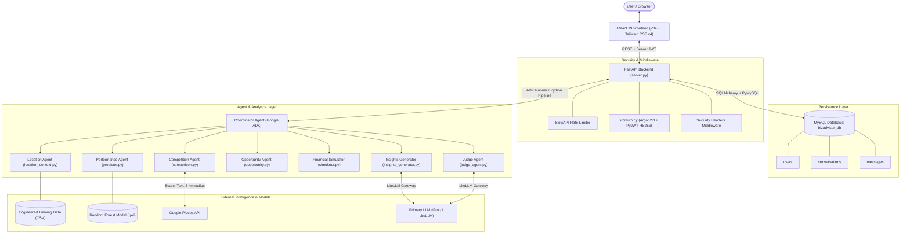

# BizAdvisor: AI-Powered Restaurant Feasibility & Business Advisory Platform

BizAdvisor is an AI-powered business intelligence and decision-support platform designed to evaluate the commercial feasibility of restaurant ventures in Bengaluru, India. The system combines machine learning performance prediction, live geospatial competitor analysis via Google Places, deterministic monthly financial modeling, specialist agent orchestration, and LLM-based business evaluation.

**Project:** BizAdvisor  
**Developer:** Tanay Chaturvedi  
**Domain:** Artificial Intelligence and Machine Learning  

> BizAdvisor coordinates specialized data and ML agents to assess location demand, classify restaurant viability, evaluate nearby market competition, simulate unit economics, and synthesize a final executive business verdict through an autonomous Judge Agent.

---

## 1. Core Capabilities

- **Required Parameter Validation:** Validates that all six essential business parameters (`location`, `primary_cuisine`, `primary_rest_type`, `approx_costfor_two_people`, `online_order`, `book_table`) are provided before triggering analysis. If parameters are missing, the system interactively requests clarifications instead of guessing.
- **Machine Learning Performance Prediction:** A Scikit-Learn `RandomForestClassifier` (300 estimators) trained on 33,332 historical Bengaluru restaurant records predicts expected performance tier (`High`, `Medium`, or `Low`) along with class probability distributions.
- **Live Competitor Discovery:** Converts Bengaluru localities into geographic coordinates and queries the Google Places API (`places:searchText`) for direct competitors within a 3 km radius, calculating competitive density, average ratings, and review counts.
- **Composite Opportunity Score (0–100):** Combines historical ML performance indicators (60% weight) and local competitive saturation (40% weight) into a normalized opportunity score and risk tier (`Low`, `Moderate`, or `High`).
- **Independent Monthly Financial Modeling:** Deterministically calculates monthly revenue, variable food costs, itemized operating expenses (rent, staff, utilities, marketing, other), operating profit, profit margin %, and break-even customer targets per day and month.
- **Judge Agent Business Verdict:** A dedicated evaluator agent powered by the Primary LLM that synthesizes all specialist findings (location, ML prediction, competition, opportunity score) into a structured verdict (`Promising`, `Risky`, or `Not Recommended`), plain-language explanation, separate strengths and risks, and one actionable recommendation.
- **AI Business Insights:** Generates concise, section-by-section analytical takeaways across location, performance, competition, opportunity, and financials using the Primary LLM.
- **User Authentication & Session Persistence:** Argon2id password hashing, PyJWT access tokens, rate limiting via SlowAPI, and complete multi-turn conversation and analysis persistence in MySQL with cascading deletes.
- **Interactive Web Interface:** React 19 single-page application built with Vite and Tailwind CSS v4, featuring analytical scorecards, Leaflet competitor maps, Judge verdict badge, and Web Speech API audio synthesis.

---

## 2. System Architecture & End-to-End Workflow



### End-to-End Workflow Steps:

1. **User Input:** User submits restaurant parameters via the React frontend form or chat interface.
2. **FastAPI Request Handling:** FastAPI (`server.py`) validates authentication and passes parameters to the orchestration layer.
3. **Coordinator Orchestration:** The Coordinator Agent manages sequential specialist evaluation.
4. **Location Analysis:** Location Agent retrieves historical neighborhood density, median costs, and delivery/booking adoption.
5. **Performance Prediction:** Performance Agent runs the Random Forest model to predict class tier and probabilities.
6. **Competition Discovery:** Competition Agent queries Google Places API for active nearby competitors within 3 km.
7. **Opportunity Scoring:** Opportunity Agent combines performance and competition signals into a composite score (0–100).
8. **Independent Financial Simulation:** Financial Simulator calculates unit economics, operating margins, and break-even points.
9. **Permitted Input Isolation for Judge:** The Coordinator filters the analysis payload to build `judge_inputs` consisting **only** of location, performance, competition, and opportunity results. **Financial Simulator output is strictly excluded from the Judge Agent.**
10. **Judge Agent Final Verdict:** The Judge Agent calls the Primary LLM to evaluate the combined specialist evidence and returns a structured verdict, explanation, separate strengths and risks, and a concrete recommendation.
11. **Frontend Presentation:** FastAPI returns the complete analysis payload. The React frontend renders the 6 specialist analytical cards followed by the Judge Verdict Card (`JudgeCard.jsx`).

---

## 3. Specialist Agent Responsibilities

| Agent / Module | Primary Function | Inputs | Outputs | Responsibility Boundary |
| :--- | :--- | :--- | :--- | :--- |
| **Location Agent** | Retrieves historical neighborhood indicators | `location` | Historical restaurant count, median cost, online order rate, table booking rate | Reads historical data from processed Zomato dataset. Does not query live APIs. |
| **Performance Agent** | Evaluates concept viability using Random Forest | Business parameters + historical location context | Predicted tier (`High`, `Medium`, `Low`) and class probability distribution | Loads preprocessor and model from `models/`. Directional ML prediction only. |
| **Competition Agent** | Discovers active competitors via Google Places | `location`, `search_query`, radius (3 km), max results (20) | Competitor list, competitor count, average rating, review count | Calls Google Places API (`places:searchText`). Requires `GOOGLE_MAPS_API_KEY`. |
| **Opportunity Agent** | Computes composite opportunity score | ML class probabilities, competition summary | Opportunity score (0–100) and risk signal (`Low`, `Moderate`, `High`) | Deterministic mathematical calculation combining ML (60%) and competition (40%). |
| **Financial Simulator** | Models monthly unit economics & break-even | Customers/day, average order value, fixed and variable costs | Revenue, expenses, operating profit, margin %, break-even targets | Independent deterministic model. Does not model taxes, loan interest, or aggregator commissions. |
| **Insights Generator** | Produces structured analytical takeaways | Analysis results & concept context | 2–3 insight bullets per section | Calls Primary LLM via LiteLLM. Returns empty lists on failure. |
| **Judge Agent** | Delivers final business assessment & verdict | Permitted specialist results (Location, ML, Competition, Opportunity) | Verdict, plain-language explanation, strengths, risks, recommendation | Powered by Primary LLM. Strictly excludes Financial Simulator data. No Python fallback verdict. |

---

## 4. Judge Agent (`src/agent/judge_agent.py`)

The Judge Agent acts as the final decision-support evaluator in BizAdvisor. After specialist agents complete their evaluations, the Judge Agent synthesizes their combined findings and delivers an authoritative, easy-to-understand verdict for restaurant owners.

### Key Characteristics:
- **Location in Codebase:** [`src/agent/judge_agent.py`](file:///src/agent/judge_agent.py)
- **Primary LLM Powered:** Uses the unified Primary LLM configuration from `src/agent/llm_config.py` via LiteLLM. It does not introduce additional models or providers.
- **Evaluation Inputs (Permitted Only):**
  1. Location suitability metrics (historical density, median pricing, delivery/booking patterns).
  2. Random Forest performance prediction (predicted tier and class confidence).
  3. Competition level (competitor count, average rating, top-tier competitors).
  4. Business opportunity score (composite score and tier).
  5. Major risks and limitations from specialist findings.
- **Financial Simulator Exclusion (Mandatory):**
  - **Financial Simulator output is never passed to or evaluated by the Judge Agent.**
  - Revenue, costs, profit, margins, and break-even targets do not influence the verdict.
  - The Financial Simulator remains fully operational and displays independently in the application (`FinancialCard.jsx`).
- **Verdict Categories:**
  - `Promising`: Encouraging demand indicators and manageable competitive barriers.
  - `Risky`: Meaningful market friction, saturation, or uncertainties requiring caution.
  - `Not Recommended`: Substantial barriers indicating high likelihood of operational or market failure.
- **Structured Output Contract:**
  ```json
  {
    "verdict": "Promising" | "Risky" | "Not Recommended",
    "explanation": "4-5 concise, natural sentences written for a non-technical restaurant owner.",
    "strengths": [
      "Positive factor from specialist analysis",
      "Encouraging market or location metric"
    ],
    "risks": [
      "Negative factor, weakness, or limitation from specialist analysis",
      "Competitive barrier or market uncertainty"
    ],
    "recommendation": "One practical, concrete action the owner can execute immediately.",
    "_judge_source": "llm_primary"
  }
  ```
- **Separation of Strengths and Risks:**
  - Positive factors are strictly placed in `strengths`.
  - Negative factors, weaknesses, and limitations are strictly placed in `risks`.
  - The frontend renders both sections side-by-side. If no risks are identified, the UI displays *"No major risks identified from the available analysis"*.
- **No Python Fallback for Verdict:**
  - The verdict and explanation are strictly generated by the Primary LLM.
  - No heuristic or deterministic Python rules substitute for the verdict.
  - If the Primary LLM fails or the API key is missing, the Judge Agent returns `verdict: "unavailable"` and `_judge_source: "error" | "missing_api_key"`.

---

## 5. Execution & Fallback Architecture

BizAdvisor maintains clear boundaries between agent orchestration failover and LLM output generation:

1. **Coordinator Orchestration Fallback (`src/agent/adk_runner.py`):**
   - The coordinator agent attempts to execute through the **Google ADK Runner** (`_run_via_adk_async`) using an `InMemorySessionService`.
   - If the ADK runtime encounters an issue (such as an unhandled session exception or tool unwrapping failure), it automatically falls back to direct deterministic Python execution (`run_full_business_analysis`).
   - This ensures the multi-agent pipeline completes reliably under all runtime environments.

2. **Judge Agent No-Fallback Principle (`src/agent/judge_agent.py`):**
   - In contrast to workflow orchestration, the Judge Agent has **no deterministic Python fallback**.
   - A business verdict must reflect authentic LLM reasoning over specialist data, not synthetic hardcoded rules.
   - If the Primary LLM call fails, times out, or returns invalid JSON, the response safely returns `verdict: "unavailable"`. The React UI gracefully handles this without breaking.

---

## 6. Machine Learning & Predictive Analytics

- **Model Type:** Scikit-Learn `RandomForestClassifier` with 300 estimators, saved at `models/zomato_performance_model.pkl`.
- **Feature Preprocessor:** Scikit-Learn `ColumnTransformer` (handling one-hot encoding for categorical variables and standard scaling for numerical features), saved at `models/zomato_preprocessor.pkl`.
- **Training Dataset:** 33,332 cleaned and engineered historical restaurant records from Bengaluru (`data/processed/zomato_train_engineered.csv`).
- **Feature Inputs:**
  - *User Business Inputs:* `online_order`, `book_table`, `approx_costfor_two_people`, `log_cost`, `cost_band`, `location`, `primary_cuisine`, `cuisine_count`, `primary_rest_type`.
  - *Historical Location Context:* `historical_restaurant_count`, `location_median_cost`, `location_online_order_rate`, `location_book_table_rate`, `location_cuisine_diversity`, `location_business_type_diversity`.
- **Target Variable:** Performance tier (`High`, `Medium`, `Low`), reflecting historical customer engagement and dining ratings.
- **Probability Output:** Uses `predict_proba()` to compute class probabilities. In the UI, Model Confidence displays the predicted-class probability percentage.

---

## 7. Financial Unit Economics Model (`src/finance/simulator.py`)

The financial simulator calculates monthly operational figures using standard managerial accounting:

$$\text{Monthly Revenue} = \text{Customers Per Day} \times \text{Working Days} \times \text{Average Order Value}$$

$$\text{Variable Food Cost} = \text{Monthly Revenue} \times \left(\frac{\text{Food Cost \%}}{100}\right)$$

$$\text{Fixed Operating Costs} = \text{Rent} + \text{Staff Cost} + \text{Utilities} + \text{Marketing} + \text{Other Expenses}$$

$$\text{Total Monthly Operating Expenses} = \text{Fixed Operating Costs} + \text{Variable Food Cost}$$

$$\text{Estimated Operating Profit} = \text{Monthly Revenue} - \text{Total Monthly Operating Expenses}$$

$$\text{Operating Profit Margin \%} = \left(\frac{\text{Estimated Operating Profit}}{\text{Monthly Revenue}}\right) \times 100$$

$$\text{Break-Even Target Customers/Day} = \left\lceil \frac{\text{Fixed Operating Costs}}{(\text{Average Order Value} - \text{Variable Cost Per Customer}) \times \text{Working Days}} \right\rceil$$

---

## 8. Technology Stack

Verified active technologies and versions:

- **Frontend:**
  - React 19 (`react: ^19.0.0`)
  - Vite (`vite: ^8.3.1`)
  - Tailwind CSS v4 (`tailwindcss: ^4.0.0`)
  - Lucide React Icons (`lucide-react: ^1.16.0`)
  - Leaflet (`leaflet: ^1.9.4`)
- **Backend & API:**
  - FastAPI (`fastapi==0.141.1`)
  - Uvicorn ASGI Server (`uvicorn==0.52.1`)
  - Pydantic (`pydantic==2.13.4`)
  - SlowAPI Rate Limiting (`slowapi==0.1.10`)
- **Security & Persistence:**
  - Argon2id Password Hashing (`argon2-cffi==25.1.0`)
  - JWT Authentication (`PyJWT==2.15.1`)
  - SQLAlchemy (`SQLAlchemy==2.1.4`)
  - PyMySQL Driver (`PyMySQL==1.2.3`)
  - MySQL Database (MySQL 8.0+)
- **Multi-Agent Orchestration & LLMs:**
  - Google ADK (`google-adk==2.6.3`)
  - Google GenAI SDK (`google-genai==2.17.0`)
  - LiteLLM Gateway (`litellm==1.97.0`)
  - Groq Cloud LLM Inference (`groq>=0.11.0`)
- **Machine Learning & Data Processing:**
  - Scikit-Learn (`scikit-learn==1.9.0`)
  - Joblib Model Serialization (`joblib==1.5.3`)
  - Pandas (`pandas==3.0.5`)
  - NumPy (`numpy==2.5.2`)
- **Geospatial & External APIs:**
  - Google Places API (New `places:searchText`)
- **Testing & Quality Assurance:**
  - Pytest (`pytest==9.1.1`)
  - HTTPX Test Client (`httpx==0.28.1`)

---

## 9. Environment Variables Reference

All runtime variables are configured in `.env` (using `.env.example` as a template):

| Variable Name | Required | Example / Default Value | Purpose |
| :--- | :---: | :--- | :--- |
| `PRIMARY_LLM_PROVIDER` | No | `groq` | Provider identifier for LiteLLM gateway. |
| `PRIMARY_LLM_MODEL` | No | `openai/gpt-oss-120b` | Model name used for Primary LLM inference. |
| `PRIMARY_LLM_API_KEY` | **Yes** | `your_primary_llm_api_key` | API key for Primary LLM inference. |
| `PRIMARY_LLM_BASE_URL` | No | `https://api.groq.com/openai/v1` | Optional API base URL for Primary LLM. |
| `GOOGLE_MAPS_API_KEY` | **Yes** | `your_google_places_api_key` | Google Maps API key for competitor queries. |
| `MYSQL_HOST` | No | `localhost` | MySQL host address. |
| `MYSQL_PORT` | No | `3306` | MySQL connection port. |
| `MYSQL_USER` | No | `root` | Database username. |
| `MYSQL_PASSWORD` | No | `your_mysql_password` | Database user password. |
| `MYSQL_DATABASE` | No | `bizadvisor_db` | MySQL database name. |
| `JWT_SECRET_KEY` | **Yes** | `min_32_characters_random_secret_key` | Secret key used to sign JWT access tokens. |
| `JWT_ALGORITHM` | No | `HS256` | Cryptographic algorithm for JWTs. |
| `ACCESS_TOKEN_EXPIRE_MINUTES` | No | `60` | Token validity duration in minutes. |
| `JWT_ISSUER` | No | `bizadvisor-api` | JWT token issuer validation string. |
| `CORS_ALLOWED_ORIGINS` | No | `http://localhost:5173,http://127.0.0.1:5173` | Comma-separated list of allowed CORS origins. |

---

## 10. Project Directory Structure

```
Business_Analysis_Agent/
├── data/
│   ├── processed/
│   │   ├── zomato_cleaned.csv            # Cleaned baseline dataset
│   │   ├── zomato_train_engineered.csv    # Engineered training data (33,332 rows)
│   │   └── zomato_test_engineered.csv     # Engineered test data (8,334 rows)
│   └── raw/
│       └── zomato.csv                     # Original raw dataset
├── frontend/                              # React 19 SPA (Vite + Tailwind CSS v4)
│   ├── src/
│   │   ├── components/
│   │   │   ├── Analysis/                  # Analytical cards (Location, Performance, etc.)
│   │   │   │   ├── JudgeCard.jsx          # Final business verdict card
│   │   │   │   ├── LocationCard.jsx
│   │   │   │   ├── PerformanceCard.jsx
│   │   │   │   ├── CompetitionCard.jsx
│   │   │   │   ├── OpportunityCard.jsx
│   │   │   │   ├── FinancialCard.jsx
│   │   │   │   ├── WhatThisMeansCard.jsx
│   │   │   │   └── AIInsightsPanel.jsx
│   │   │   ├── AudioPlayer/               # Web Speech API TTS player
│   │   │   ├── Auth/                      # Authentication modals
│   │   │   ├── Chat/                      # Message list & input components
│   │   │   ├── Map/                       # Leaflet interactive map modal
│   │   │   └── Sidebar/                   # Conversation history sidebar
│   │   ├── services/
│   │   │   └── api.js                     # Axios HTTP client with JWT interceptor
│   │   ├── App.jsx                        # Root React component
│   │   ├── index.css                      # Styling & theme variables
│   │   └── main.jsx                       # DOM entrypoint
│   ├── package.json
│   └── vite.config.js
├── models/
│   ├── zomato_performance_model.pkl       # 300-estimator Random Forest classifier
│   └── zomato_preprocessor.pkl            # Scikit-Learn ColumnTransformer
├── notebooks/                             # Exploratory data analysis & training
│   ├── 01_data_cleaning.ipynb
│   ├── 02_feature_engineering.ipynb
│   └── 05_zomato_model_training.ipynb
├── src/
│   ├── agent/                             # Multi-agent orchestration
│   │   ├── adk_runner.py                  # Google ADK runner interface
│   │   ├── agent.py                       # Root agent registration
│   │   ├── competition_agent.py           # Competitor analysis agent
│   │   ├── coordinator_agent.py           # Master coordinator pipeline
│   │   ├── insights_generator.py          # Structured AI insights generator
│   │   ├── judge_agent.py                 # Final business verdict generator
│   │   ├── llm_config.py                  # Unified Primary LLM configuration
│   │   ├── location_agent.py              # Location context agent
│   │   ├── opportunity_agent.py           # Opportunity scoring agent
│   │   └── performance_agent.py           # ML performance agent
│   ├── analysis/
│   │   ├── location_context.py            # Historical neighborhood metrics lookup
│   │   └── opportunity.py                 # Opportunity score algorithm
│   ├── finance/
│   │   └── simulator.py                   # Deterministic unit economics model
│   ├── places/
│   │   └── competition.py                 # Google Places API client
│   ├── auth.py                            # Argon2id password hashing & PyJWT
│   └── database.py                        # SQLAlchemy MySQL models & session pool
├── tests/
│   ├── test_judge_agent.py                # Judge Agent unit tests (17 tests)
│   ├── test_financial_accuracy.py         # Financial calculation unit tests (11 tests)
│   ├── test_mysql_integration.py          # Database CRUD integration tests (4 tests)
│   ├── test_mysql_regression.py           # Session recovery regression tests (5 tests)
│   └── test_security.py                   # Auth, JWT, rate limiting tests (13 tests)
├── .env.example                           # Sample environment configuration
├── requirements.txt                       # Backend Python dependencies
├── server.py                              # FastAPI backend entrypoint
└── README.md
```

---

## 11. Installation & Setup

### Prerequisites
- **Python:** 3.11 or higher
- **Node.js:** 18 or higher (with npm)
- **MySQL:** 8.0 or higher
- **API Keys:**
  - Google Places API key (with the **Places API (New)** enabled).
  - Primary LLM API key (e.g., Groq API key).

### 1. Set Up Python Virtual Environment
```powershell
# Create and activate virtual environment
python -m venv .venv
.\.venv\Scripts\Activate.ps1

# Install backend dependencies
python -m pip install --upgrade pip
pip install -r requirements.txt
```

### 2. Configure Environment Variables
Copy `.env.example` to `.env` and fill in your credentials:
```powershell
Copy-Item .env.example .env
```
Ensure that `JWT_SECRET_KEY` is a secure random string of at least 32 characters.

### 3. Initialize MySQL Database
Create the database in MySQL:
```sql
CREATE DATABASE IF NOT EXISTS bizadvisor_db CHARACTER SET utf8mb4 COLLATE utf8mb4_unicode_ci;
```
Database tables (`users`, `conversations`, `messages`) are created automatically when the FastAPI server starts via `Base.metadata.create_all(bind=engine)`.

### 4. Install Frontend Dependencies
```powershell
cd frontend
npm install
cd ..
```

---

## 12. Running the Application

### Development Mode

Run the backend and frontend in separate terminals:

**Terminal 1 — Backend:**
```powershell
.\.venv\Scripts\Activate.ps1
uvicorn server:app --host 127.0.0.1 --port 8000 --reload
```
The API is available at `http://127.0.0.1:8000` (interactive documentation at `http://127.0.0.1:8000/docs`).

**Terminal 2 — Frontend:**
```powershell
cd frontend
npm run dev
```
The frontend is available at `http://localhost:5173`.

### Production Build

To build the frontend and serve it directly through FastAPI:
```powershell
cd frontend
npm run build
cd ..
uvicorn server:app --host 0.0.0.0 --port 8000
```

---

## 13. Testing & Verification

Run the automated test suite with pytest:
```powershell
.\.venv\Scripts\Activate.ps1
pytest tests/ -v
```

### Test Suite Summary:
- **`tests/test_judge_agent.py` (17 tests):** Validates all three verdict categories (`Promising`, `Risky`, `Not Recommended`), separation of strengths and risks, API failure handling, missing key safeguards, exclusion of financial simulator inputs, and JSON parsing with markdown fences.
- **`tests/test_financial_accuracy.py` (11 tests):** Verifies monthly revenue, food costs, operating profit, margins, break-even customer formulas, zero-revenue safety, and invalid input rejection.
- **`tests/test_security.py` (13 tests):** Verifies Argon2id password hashing, credential validation, JWT token expiration, route protection, cross-user data isolation, rate limiting, and startup secret key validation.
- **`tests/test_mysql_integration.py` (4 tests):** Verifies MySQL schema generation, conversation CRUD, cascading deletes, and analysis payload persistence.
- **`tests/test_mysql_regression.py` (5 tests):** Verifies multi-turn session creation, conversation updates, boolean parameter extraction, and recovery from stale session data.

---

## Developer & Project Information

- **Developer:** Tanay Chaturvedi
- **Domain:** Artificial Intelligence and Machine Learning
- **Project:** BizAdvisor — Restaurant Feasibility & Business Advisory Platform
